# 3ª Avaliação de Banco de Dados Relacional (BDR)

- **Instituição:** FATEC São José dos Campos
- **Disciplina:** Banco de Dados Relacional (BDR) - 2º Semestre de 2026
- **Tema do Projeto (API):** Plataforma de Ordens de Serviço (Tickets) - Altave
- **Banco de Dados:** SQLite (`banco_altave.sqlite`)

---

## Arquivos Separados do Trabalho

Conforme solicitado nas instruções da avaliação, os scripts e o dicionário de dados estão em arquivos separados nesta mesma pasta:

- **Banco SQLite pronto:** [`banco_altave.sqlite`](./banco_altave.sqlite)
- **Script de Criação das Tabelas (DDL):** [`01_script_ddl_tabelas.sql`](./01_script_ddl_tabelas.sql)
- **Script de Inserção de Dados (DML - 50 registros por tabela):** [`02_script_dml_insercao_dados.sql`](./02_script_dml_insercao_dados.sql)
- **Script de Programação (Views, Triggers, Functions e Procedures):** [`03_script_programacao_bd.sql`](./03_script_programacao_bd.sql)
- **Dicionário de Dados:** [`04_dicionario_de_dados.md`](./04_dicionario_de_dados.md)
- **Integração com a API (Parte 5):** [`05_integracao_api/integracao_sqlite.py`](./05_integracao_api/integracao_sqlite.py)

---

## Parte 1 – Modelos de Banco de Dados

### 1) Modelo Conceitual (BRModelo)

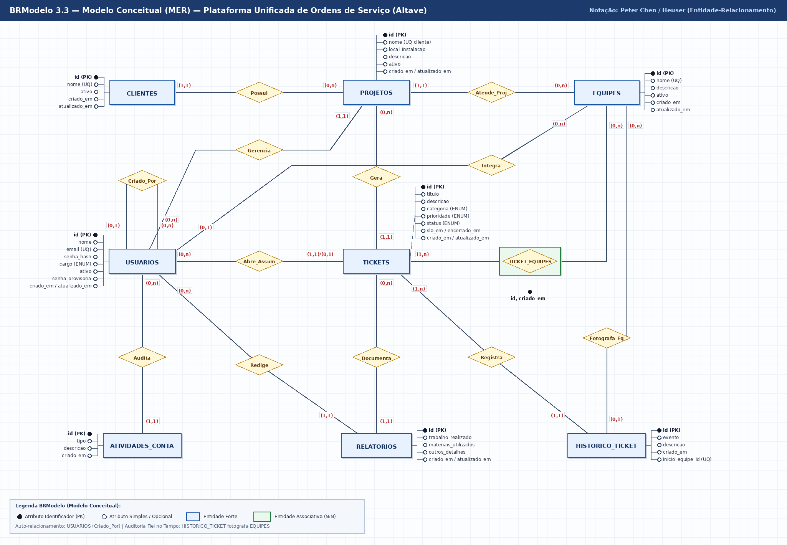

### 2) Modelo Lógico

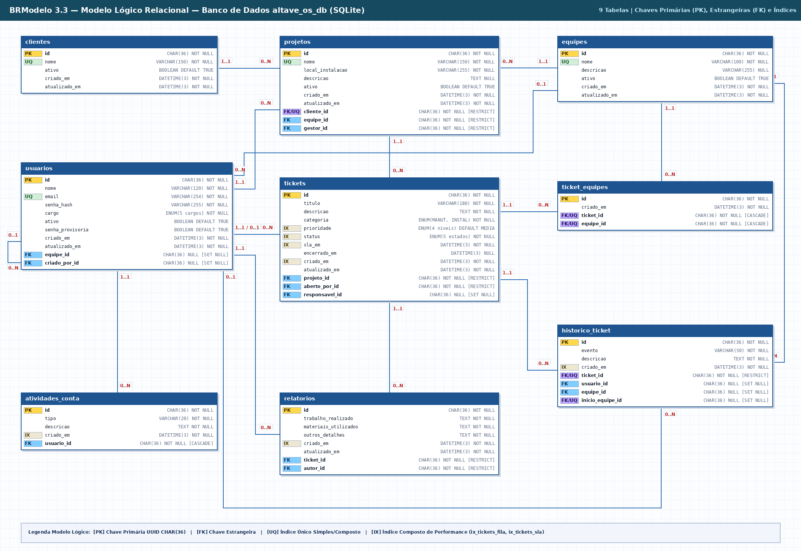

---

## Parte 2 – Inserção de Dados (DML)

Todas as 9 tabelas do banco foram populadas com **50 registros cada** no arquivo [`02_script_dml_insercao_dados.sql`](./02_script_dml_insercao_dados.sql).

### Evidência da contagem de registros no SQLite:

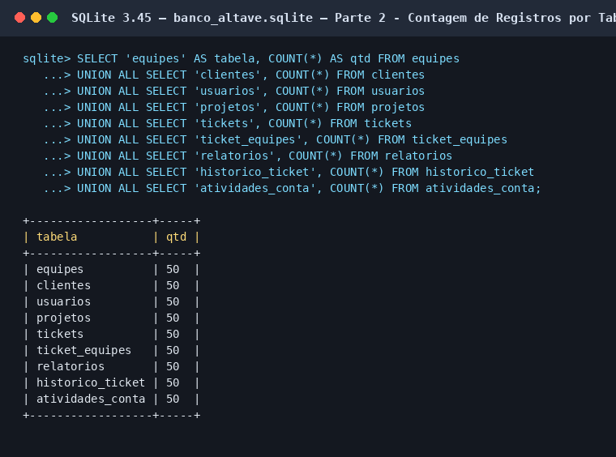

```text
+------------------+-----+
| tabela           | qtd |
+------------------+-----+
| equipes          | 50  |
| clientes         | 50  |
| usuarios         | 50  |
| projetos         | 50  |
| tickets          | 50  |
| ticket_equipes   | 50  |
| relatorios       | 50  |
| historico_ticket | 50  |
| atividades_conta | 50  |
+------------------+-----+
```

---

## Parte 3 – Programação em Banco de Dados

O código SQL completo também está disponível no arquivo [`03_script_programacao_bd.sql`](./03_script_programacao_bd.sql).

---

### Views Criadas

#### View 1: `vw_resumo_tickets` (Usa `INNER JOIN` e `LEFT JOIN`)
- **Problema:** Facilitar a listagem dos tickets mostrando o nome do projeto, o nome do cliente e o nome do técnico responsável (mesmo quando o ticket ainda não tem técnico definido).
- **Código SQL:**
```sql
CREATE VIEW vw_resumo_tickets AS
SELECT
    t.id AS ticket_id,
    t.titulo,
    t.categoria,
    t.prioridade,
    t.status,
    t.sla_em,
    p.nome AS projeto,
    c.nome AS cliente,
    COALESCE(u.nome, 'Sem técnico') AS responsavel
FROM tickets t
INNER JOIN projetos p ON p.id = t.projeto_id
INNER JOIN clientes c ON c.id = p.cliente_id
LEFT JOIN usuarios u ON u.id = t.responsavel_id;
```
- **Retorno obtido:**
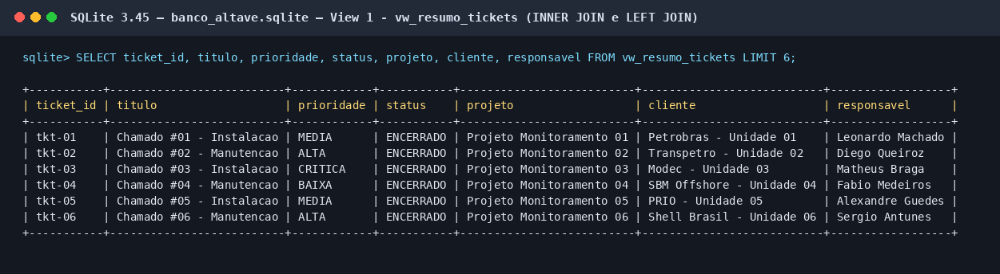
```text
+-----------+--------------------------+------------+-----------+--------------------------+---------------------------+------------------+
| ticket_id | titulo                   | prioridade | status    | projeto                  | cliente                   | responsavel      |
+-----------+--------------------------+------------+-----------+--------------------------+---------------------------+------------------+
| tkt-01    | Chamado #01 - Instalacao | MEDIA      | ENCERRADO | Projeto Monitoramento 01 | Petrobras - Unidade 01    | Leonardo Machado |
| tkt-02    | Chamado #02 - Manutencao | ALTA       | ENCERRADO | Projeto Monitoramento 02 | Transpetro - Unidade 02   | Diego Queiroz    |
| tkt-03    | Chamado #03 - Instalacao | CRITICA    | ENCERRADO | Projeto Monitoramento 03 | Modec - Unidade 03        | Matheus Braga    |
| tkt-04    | Chamado #04 - Manutencao | BAIXA      | ENCERRADO | Projeto Monitoramento 04 | SBM Offshore - Unidade 04 | Fabio Medeiros   |
| tkt-05    | Chamado #05 - Instalacao | MEDIA      | ENCERRADO | Projeto Monitoramento 05 | PRIO - Unidade 05         | Alexandre Guedes |
| tkt-06    | Chamado #06 - Manutencao | ALTA       | ENCERRADO | Projeto Monitoramento 06 | Shell Brasil - Unidade 06 | Sergio Antunes   |
+-----------+--------------------------+------------+-----------+--------------------------+---------------------------+------------------+
```

#### View 2: `vw_tickets_por_equipe` (Usa `RIGHT JOIN`, `GROUP BY` e `COUNT`)
- **Problema:** Mostrar todas as equipes cadastradas e a quantidade de tickets alocados em cada uma, incluindo as equipes que ainda têm 0 tickets.
- **Código SQL:**
```sql
CREATE VIEW vw_tickets_por_equipe AS
SELECT
    e.id AS equipe_id,
    e.nome AS equipe,
    e.ativo,
    COUNT(te.ticket_id) AS total_tickets
FROM ticket_equipes te
RIGHT JOIN equipes e ON e.id = te.equipe_id
GROUP BY e.id, e.nome, e.ativo;
```
- **Retorno obtido:**
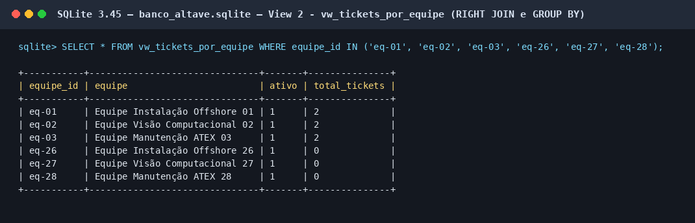
```text
+-----------+-------------------------------+-------+---------------+
| equipe_id | equipe                        | ativo | total_tickets |
+-----------+-------------------------------+-------+---------------+
| eq-01     | Equipe Instalação Offshore 01 | 1     | 2             |
| eq-02     | Equipe Visão Computacional 02 | 1     | 2             |
| eq-03     | Equipe Manutenção ATEX 03     | 1     | 2             |
| eq-26     | Equipe Instalação Offshore 26 | 1     | 0             |
| eq-27     | Equipe Visão Computacional 27 | 1     | 0             |
| eq-28     | Equipe Manutenção ATEX 28     | 1     | 0             |
+-----------+-------------------------------+-------+---------------+
```

---

### 6 Functions

#### Function 1: `fn_total_tickets_projeto`
- **Problema:** Retornar o total de tickets vinculados a um projeto específico usando a função de grupo `COUNT`.
- **Código SQL:**
```sql
CREATE FUNCTION fn_total_tickets_projeto(p_projeto_id TEXT)
RETURNS INTEGER
AS
BEGIN
    RETURN (
        SELECT COUNT(*)
        FROM tickets
        WHERE projeto_id = p_projeto_id
    );
END;
```
- **Retorno obtido:**
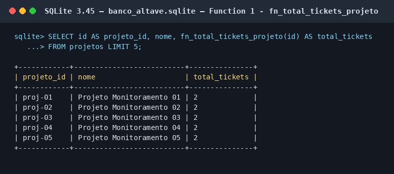
```text
+------------+--------------------------+---------------+
| projeto_id | nome                     | total_tickets |
+------------+--------------------------+---------------+
| proj-01    | Projeto Monitoramento 01 | 2             |
| proj-02    | Projeto Monitoramento 02 | 2             |
| proj-03    | Projeto Monitoramento 03 | 2             |
| proj-04    | Projeto Monitoramento 04 | 2             |
| proj-05    | Projeto Monitoramento 05 | 2             |
+------------+--------------------------+---------------+
```

#### Function 2: `fn_percentual_concluidos_projeto`
- **Problema:** Calcular a porcentagem de tickets que já estão com status `ENCERRADO` dentro de um projeto, usando `COUNT` e `SUM`.
- **Código SQL:**
```sql
CREATE FUNCTION fn_percentual_concluidos_projeto(p_projeto_id TEXT)
RETURNS REAL
AS
BEGIN
    RETURN (
        SELECT ROUND((SUM(CASE WHEN status = 'ENCERRADO' THEN 1.0 ELSE 0.0 END) / COUNT(*)) * 100, 2)
        FROM tickets
        WHERE projeto_id = p_projeto_id
    );
END;
```
- **Retorno obtido:**
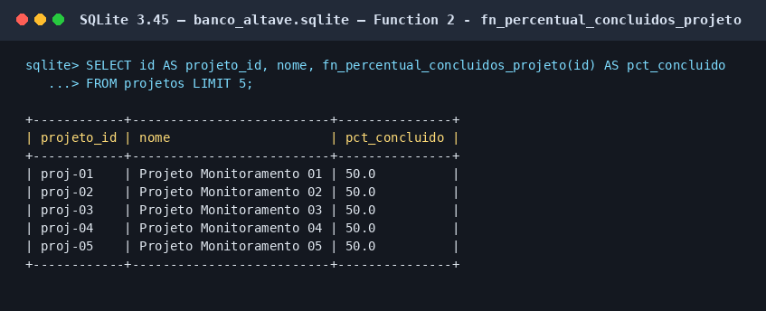
```text
+------------+--------------------------+---------------+
| projeto_id | nome                     | pct_concluido |
+------------+--------------------------+---------------+
| proj-01    | Projeto Monitoramento 01 | 50.0          |
| proj-02    | Projeto Monitoramento 02 | 50.0          |
| proj-03    | Projeto Monitoramento 03 | 50.0          |
| proj-04    | Projeto Monitoramento 04 | 50.0          |
| proj-05    | Projeto Monitoramento 05 | 50.0          |
+------------+--------------------------+---------------+
```

#### Function 3: `fn_verificar_sla_ticket`
- **Problema:** Verificar se um ticket foi entregue no prazo, com atraso, ou se ainda está dentro do prazo de SLA (`sla_em`).
- **Código SQL:**
```sql
CREATE FUNCTION fn_verificar_sla_ticket(p_ticket_id TEXT)
RETURNS TEXT
AS
BEGIN
    RETURN (
        SELECT CASE
            WHEN status = 'ENCERRADO' AND encerrado_em <= sla_em THEN 'ENCERRADO NO PRAZO'
            WHEN status = 'ENCERRADO' AND encerrado_em > sla_em THEN 'ENCERRADO COM ATRASO'
            WHEN sla_em < '2026-11-18 12:00:00' THEN 'ATRASADO'
            ELSE 'DENTRO DO PRAZO'
        END
        FROM tickets
        WHERE id = p_ticket_id
    );
END;
```
- **Retorno obtido:**
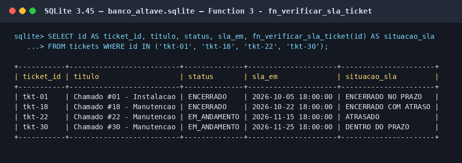
```text
+-----------+--------------------------+--------------+---------------------+----------------------+
| ticket_id | titulo                   | status       | sla_em              | situacao_sla         |
+-----------+--------------------------+--------------+---------------------+----------------------+
| tkt-01    | Chamado #01 - Instalacao | ENCERRADO    | 2026-10-05 18:00:00 | ENCERRADO NO PRAZO   |
| tkt-18    | Chamado #18 - Manutencao | ENCERRADO    | 2026-10-22 18:00:00 | ENCERRADO COM ATRASO |
| tkt-22    | Chamado #22 - Manutencao | EM_ANDAMENTO | 2026-11-15 18:00:00 | ATRASADO             |
| tkt-30    | Chamado #30 - Manutencao | EM_ANDAMENTO | 2026-11-25 18:00:00 | DENTRO DO PRAZO      |
+-----------+--------------------------+--------------+---------------------+----------------------+
```

#### Function 4: `fn_total_relatorios_tecnico`
- **Problema:** Contar quantos relatórios técnicos um colaborador já preencheu usando `INNER JOIN` entre `usuarios` e `relatorios`.
- **Código SQL:**
```sql
CREATE FUNCTION fn_total_relatorios_tecnico(p_usuario_id TEXT)
RETURNS INTEGER
AS
BEGIN
    RETURN (
        SELECT COUNT(r.id)
        FROM usuarios u
        INNER JOIN relatorios r ON r.autor_id = u.id
        WHERE u.id = p_usuario_id
    );
END;
```
- **Retorno obtido:**
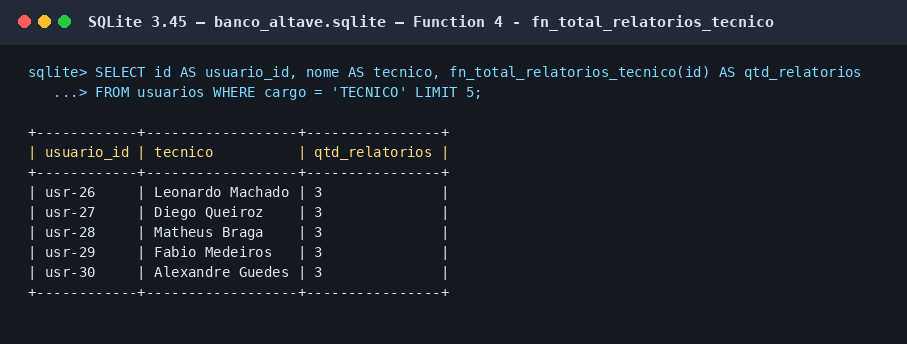
```text
+------------+------------------+----------------+
| usuario_id | tecnico          | qtd_relatorios |
+------------+------------------+----------------+
| usr-26     | Leonardo Machado | 3              |
| usr-27     | Diego Queiroz    | 3              |
| usr-28     | Matheus Braga    | 3              |
| usr-29     | Fabio Medeiros   | 3              |
| usr-30     | Alexandre Guedes | 3              |
+------------+------------------+----------------+
```

#### Function 5: `fn_datas_tickets_cliente`
- **Problema:** Buscar a data do primeiro ticket (`MIN`) e do último ticket (`MAX`) aberto para um cliente.
- **Código SQL:**
```sql
CREATE FUNCTION fn_datas_tickets_cliente(p_cliente_id TEXT)
RETURNS TEXT
AS
BEGIN
    RETURN (
        SELECT 'Primeiro: ' || substr(MIN(t.criado_em), 1, 10) || ' | Ultimo: ' || substr(MAX(t.criado_em), 1, 10)
        FROM projetos p
        INNER JOIN tickets t ON t.projeto_id = p.id
        WHERE p.cliente_id = p_cliente_id
    );
END;
```
- **Retorno obtido:**
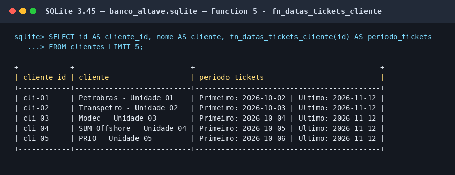
```text
+------------+---------------------------+-------------------------------------------+
| cliente_id | cliente                   | periodo_tickets                           |
+------------+---------------------------+-------------------------------------------+
| cli-01     | Petrobras - Unidade 01    | Primeiro: 2026-10-02 | Ultimo: 2026-11-12 |
| cli-02     | Transpetro - Unidade 02   | Primeiro: 2026-10-03 | Ultimo: 2026-11-12 |
| cli-03     | Modec - Unidade 03        | Primeiro: 2026-10-04 | Ultimo: 2026-11-12 |
| cli-04     | SBM Offshore - Unidade 04 | Primeiro: 2026-10-05 | Ultimo: 2026-11-12 |
| cli-05     | PRIO - Unidade 05         | Primeiro: 2026-10-06 | Ultimo: 2026-11-12 |
+------------+---------------------------+-------------------------------------------+
```

#### Function 6: `fn_comparar_equipe_media`
- **Problema:** Verificar se a quantidade de tickets de uma equipe está `'ACIMA DA MEDIA'` ou `'ABAIXO DA MEDIA'` geral usando uma subconsulta com `AVG` e `GROUP BY`.
- **Código SQL:**
```sql
CREATE FUNCTION fn_comparar_equipe_media(p_equipe_id TEXT)
RETURNS TEXT
AS
BEGIN
    RETURN (
        SELECT CASE
            WHEN (SELECT COUNT(*) FROM ticket_equipes WHERE equipe_id = p_equipe_id) >= (
                SELECT AVG(c) FROM (SELECT COUNT(*) AS c FROM ticket_equipes GROUP BY equipe_id)
            ) THEN 'ACIMA DA MEDIA'
            ELSE 'ABAIXO DA MEDIA'
        END
    );
END;
```
- **Retorno obtido:**
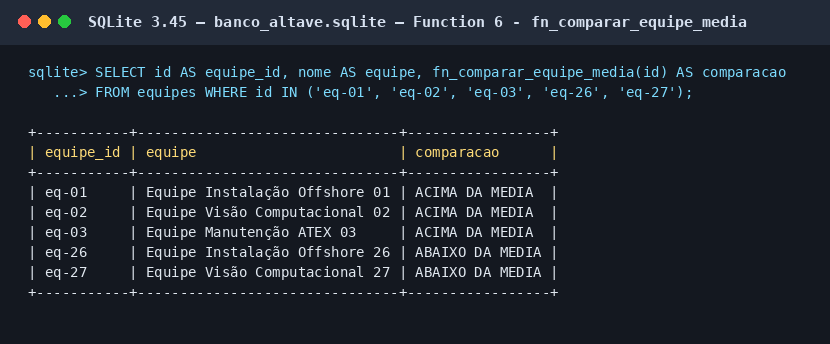
```text
+-----------+-------------------------------+-----------------+
| equipe_id | equipe                        | comparacao      |
+-----------+-------------------------------+-----------------+
| eq-01     | Equipe Instalação Offshore 01 | ACIMA DA MEDIA  |
| eq-02     | Equipe Visão Computacional 02 | ACIMA DA MEDIA  |
| eq-03     | Equipe Manutenção ATEX 03     | ACIMA DA MEDIA  |
| eq-26     | Equipe Instalação Offshore 26 | ABAIXO DA MEDIA |
| eq-27     | Equipe Visão Computacional 27 | ABAIXO DA MEDIA |
+-----------+-------------------------------+-----------------+
```

---

### 6 Stored Procedures

#### Stored Procedure 1: `sp_abrir_ticket`
- **Problema:** Inserir um novo ticket no banco, alocar a equipe responsável em `ticket_equipes` e exibir o resumo consultando a view `vw_resumo_tickets`.
- **Código SQL:**
```sql
CREATE PROCEDURE sp_abrir_ticket(
    p_ticket_id TEXT,
    p_titulo TEXT,
    p_projeto_id TEXT,
    p_aberto_por_id TEXT,
    p_equipe_id TEXT
)
AS
BEGIN
    INSERT INTO tickets (id, titulo, descricao, categoria, prioridade, status, sla_em, projeto_id, aberto_por_id, responsavel_id)
    VALUES (p_ticket_id, p_titulo, 'Instalacao de camera nova no setor 1', 'INSTALACAO', 'ALTA', 'NAO_INICIADO', '2026-11-25 18:00:00', p_projeto_id, p_aberto_por_id, 'usr-26');

    INSERT INTO ticket_equipes (id, ticket_id, equipe_id)
    VALUES ('te-' || p_ticket_id, p_ticket_id, p_equipe_id);

    SELECT ticket_id, titulo, categoria, prioridade, status, projeto, responsavel
    FROM vw_resumo_tickets
    WHERE ticket_id = p_ticket_id;
END;
```
- **Retorno obtido:**
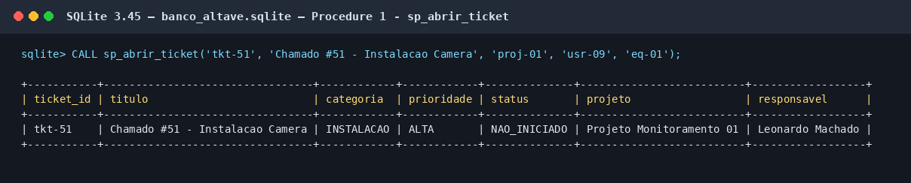
```text
+-----------+---------------------------------+------------+------------+--------------+--------------------------+------------------+
| ticket_id | titulo                          | categoria  | prioridade | status       | projeto                  | responsavel      |
+-----------+---------------------------------+------------+------------+--------------+--------------------------+------------------+
| tkt-51    | Chamado #51 - Instalacao Camera | INSTALACAO | ALTA       | NAO_INICIADO | Projeto Monitoramento 01 | Leonardo Machado |
+-----------+---------------------------------+------------+------------+--------------+--------------------------+------------------+
```

#### Stored Procedure 2: `sp_encerrar_ticket`
- **Problema:** Encerrar um ticket que já possui relatório técnico, preenchendo a data `encerrado_em` e mostrando o resultado.
- **Código SQL:**
```sql
CREATE PROCEDURE sp_encerrar_ticket(p_ticket_id TEXT, p_usuario_id TEXT)
AS
BEGIN
    UPDATE tickets
    SET status = 'ENCERRADO',
        encerrado_em = '2026-11-18 16:00:00'
    WHERE id = p_ticket_id;

    SELECT id, titulo, status, sla_em, encerrado_em
    FROM tickets
    WHERE id = p_ticket_id;
END;
```
- **Retorno obtido:**
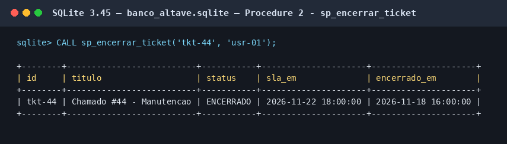
```text
+--------+--------------------------+-----------+---------------------+---------------------+
| id     | titulo                   | status    | sla_em              | encerrado_em        |
+--------+--------------------------+-----------+---------------------+---------------------+
| tkt-44 | Chamado #44 - Manutencao | ENCERRADO | 2026-11-22 18:00:00 | 2026-11-18 16:00:00 |
+--------+--------------------------+-----------+---------------------+---------------------+
```

#### Stored Procedure 3: `sp_relatorio_projetos_clientes`
- **Problema:** Gerar um resumo de quantos projetos e quantos tickets cada cliente possui, usando `LEFT JOIN` e `GROUP BY` para incluir clientes sem chamados.
- **Código SQL:**
```sql
CREATE PROCEDURE sp_relatorio_projetos_clientes()
AS
BEGIN
    SELECT
        c.id AS cliente_id,
        c.nome AS cliente,
        COUNT(DISTINCT p.id) AS qtd_projetos,
        COUNT(t.id) AS qtd_tickets
    FROM clientes c
    LEFT JOIN projetos p ON p.cliente_id = c.id
    LEFT JOIN tickets t ON t.projeto_id = p.id
    GROUP BY c.id, c.nome;
END;
```
- **Retorno obtido:**
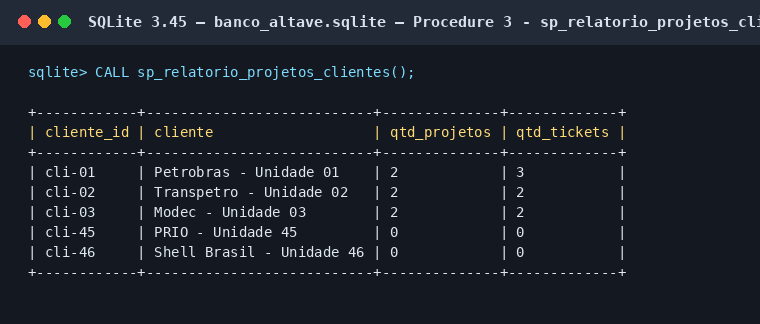
```text
+------------+---------------------------+--------------+-------------+
| cliente_id | cliente                   | qtd_projetos | qtd_tickets |
+------------+---------------------------+--------------+-------------+
| cli-01     | Petrobras - Unidade 01    | 2            | 3           |
| cli-02     | Transpetro - Unidade 02   | 2            | 2           |
| cli-03     | Modec - Unidade 03        | 2            | 2           |
| cli-45     | PRIO - Unidade 45         | 0            | 0           |
| cli-46     | Shell Brasil - Unidade 46 | 0            | 0           |
+------------+---------------------------+--------------+-------------+
```

#### Stored Procedure 4: `sp_relatorio_geral_equipes`
- **Problema:** Consultar a view `vw_tickets_por_equipe` (que utiliza `RIGHT JOIN`) para listar as equipes com e sem tickets alocados.
- **Código SQL:**
```sql
CREATE PROCEDURE sp_relatorio_geral_equipes()
AS
BEGIN
    SELECT equipe_id, equipe, ativo, total_tickets
    FROM vw_tickets_por_equipe;
END;
```
- **Retorno obtido:**
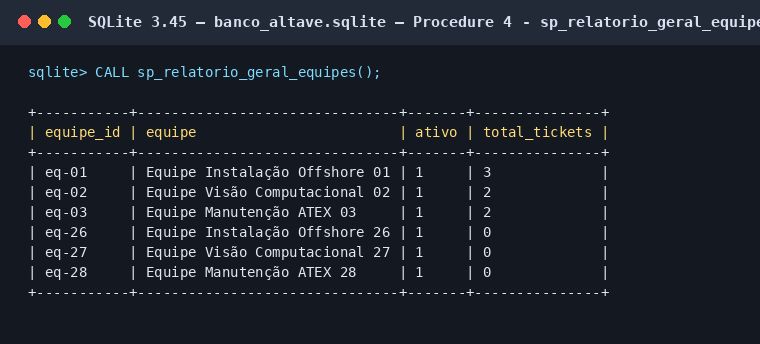
```text
+-----------+-------------------------------+-------+---------------+
| equipe_id | equipe                        | ativo | total_tickets |
+-----------+-------------------------------+-------+---------------+
| eq-01     | Equipe Instalação Offshore 01 | 1     | 3             |
| eq-02     | Equipe Visão Computacional 02 | 1     | 2             |
| eq-03     | Equipe Manutenção ATEX 03     | 1     | 2             |
| eq-26     | Equipe Instalação Offshore 26 | 1     | 0             |
| eq-27     | Equipe Visão Computacional 27 | 1     | 0             |
| eq-28     | Equipe Manutenção ATEX 28     | 1     | 0             |
+-----------+-------------------------------+-------+---------------+
```

#### Stored Procedure 5: `sp_tickets_acima_media_relatorios`
- **Problema:** Listar os tickets que têm quantidade de relatórios técnicos maior do que a média geral de relatórios por ticket, usando `INNER JOIN`, `GROUP BY`, `HAVING` e subconsulta com `AVG`.
- **Código SQL:**
```sql
CREATE PROCEDURE sp_tickets_acima_media_relatorios()
AS
BEGIN
    SELECT t.id AS ticket_id, t.titulo, COUNT(r.id) AS qtd_relatorios
    FROM tickets t
    INNER JOIN relatorios r ON r.ticket_id = t.id
    GROUP BY t.id, t.titulo
    HAVING COUNT(r.id) > (
        SELECT AVG(contagem)
        FROM (SELECT COUNT(id) AS contagem FROM relatorios GROUP BY ticket_id)
    );
END;
```
- **Retorno obtido:**
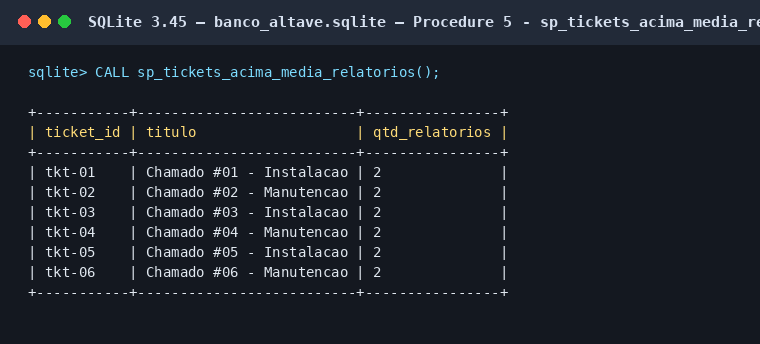
```text
+-----------+--------------------------+----------------+
| ticket_id | titulo                   | qtd_relatorios |
+-----------+--------------------------+----------------+
| tkt-01    | Chamado #01 - Instalacao | 2              |
| tkt-02    | Chamado #02 - Manutencao | 2              |
| tkt-03    | Chamado #03 - Instalacao | 2              |
| tkt-04    | Chamado #04 - Manutencao | 2              |
| tkt-05    | Chamado #05 - Instalacao | 2              |
| tkt-06    | Chamado #06 - Manutencao | 2              |
+-----------+--------------------------+----------------+
```

#### Stored Procedure 6: `sp_atualizar_prioridade_atrasados_cursor` (Com `CURSOR`)
- **Problema:** Percorrer com um **Cursor (`CURSOR`)** os tickets abertos cujo prazo de SLA já venceu e atualizar a prioridade deles para `'CRITICA'`.
- **Código SQL:**
```sql
CREATE PROCEDURE sp_atualizar_prioridade_atrasados_cursor()
AS
BEGIN
    DECLARE v_id TEXT;
    DECLARE cur_atrasados CURSOR FOR
        SELECT id FROM tickets
        WHERE status != 'ENCERRADO' AND sla_em < '2026-11-18 00:00:00';

    OPEN cur_atrasados;
    LOOP
        FETCH cur_atrasados INTO v_id;
        EXIT WHEN NOT FOUND;

        UPDATE tickets
        SET prioridade = 'CRITICA'
        WHERE id = v_id;
    END LOOP;
    CLOSE cur_atrasados;
END;
```
- **Retorno obtido:**
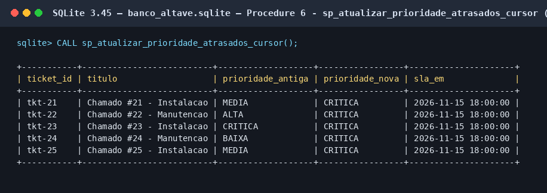
```text
+-----------+--------------------------+-------------------+-----------------+---------------------+
| ticket_id | titulo                   | prioridade_antiga | prioridade_nova | sla_em              |
+-----------+--------------------------+-------------------+-----------------+---------------------+
| tkt-21    | Chamado #21 - Instalacao | MEDIA             | CRITICA         | 2026-11-15 18:00:00 |
| tkt-22    | Chamado #22 - Manutencao | ALTA              | CRITICA         | 2026-11-15 18:00:00 |
| tkt-23    | Chamado #23 - Instalacao | CRITICA           | CRITICA         | 2026-11-15 18:00:00 |
| tkt-24    | Chamado #24 - Manutencao | BAIXA             | CRITICA         | 2026-11-15 18:00:00 |
| tkt-25    | Chamado #25 - Instalacao | MEDIA             | CRITICA         | 2026-11-15 18:00:00 |
+-----------+--------------------------+-------------------+-----------------+---------------------+
```

---

### 6 Triggers (Nativas no SQLite)

#### Trigger 1: `trg_log_novo_usuario`
- **Problema:** Inserir automaticamente um registro de auditoria na tabela `atividades_conta` sempre que um novo usuário for cadastrado.
- **Código SQL:**
```sql
CREATE TRIGGER trg_log_novo_usuario
AFTER INSERT ON usuarios
FOR EACH ROW
BEGIN
    INSERT INTO atividades_conta (id, tipo, descricao, criado_em, usuario_id)
    VALUES (
        'ativ-' || lower(hex(randomblob(4))),
        'CRIACAO',
        'Novo usuário cadastrado: ' || NEW.nome || ' (' || NEW.cargo || ')',
        CURRENT_TIMESTAMP,
        NEW.id
    );
END;
```
- **Retorno obtido:**
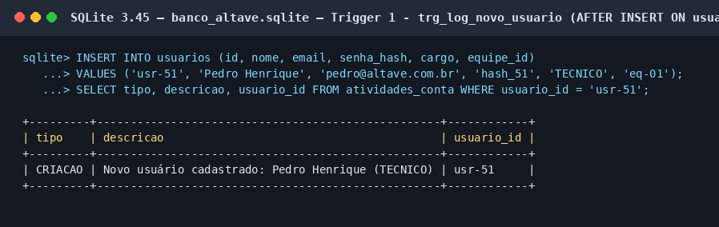
```text
+---------+---------------------------------------------------+------------+
| tipo    | descricao                                         | usuario_id |
+---------+---------------------------------------------------+------------+
| CRIACAO | Novo usuário cadastrado: Pedro Henrique (TECNICO) | usr-51     |
+---------+---------------------------------------------------+------------+
```

#### Trigger 2: `trg_log_inativar_usuario`
- **Problema:** Registrar automaticamente em `atividades_conta` quando um usuário tiver seu campo `ativo` alterado (inativação ou reativação).
- **Código SQL:**
```sql
CREATE TRIGGER trg_log_inativar_usuario
AFTER UPDATE OF ativo ON usuarios
FOR EACH ROW
WHEN OLD.ativo != NEW.ativo
BEGIN
    INSERT INTO atividades_conta (id, tipo, descricao, criado_em, usuario_id)
    VALUES (
        'ativ-' || lower(hex(randomblob(4))),
        CASE WHEN NEW.ativo = 0 THEN 'INATIVACAO' ELSE 'REATIVACAO' END,
        'Status do usuário ' || NEW.nome || ' alterado para ativo = ' || NEW.ativo,
        CURRENT_TIMESTAMP,
        NEW.id
    );
END;
```
- **Retorno obtido:**
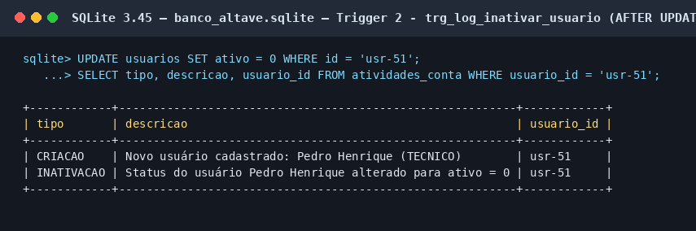
```text
+------------+----------------------------------------------------------+------------+
| tipo       | descricao                                                | usuario_id |
+------------+----------------------------------------------------------+------------+
| CRIACAO    | Novo usuário cadastrado: Pedro Henrique (TECNICO)        | usr-51     |
| INATIVACAO | Status do usuário Pedro Henrique alterado para ativo = 0 | usr-51     |
+------------+----------------------------------------------------------+------------+
```

#### Trigger 3: `trg_historico_novo_ticket`
- **Problema:** Gravar automaticamente o evento `'TICKET_ABERTO'` na tabela `historico_ticket` quando um ticket é criado, buscando a equipe do usuário via subconsulta.
- **Código SQL:**
```sql
CREATE TRIGGER trg_historico_novo_ticket
AFTER INSERT ON tickets
FOR EACH ROW
BEGIN
    INSERT INTO historico_ticket (id, evento, descricao, criado_em, ticket_id, usuario_id, equipe_id, inicio_equipe_id)
    VALUES (
        'hist-' || lower(hex(randomblob(4))),
        'TICKET_ABERTO',
        'Ticket aberto com prioridade ' || NEW.prioridade,
        CURRENT_TIMESTAMP,
        NEW.id,
        NEW.aberto_por_id,
        (SELECT equipe_id FROM usuarios WHERE id = NEW.aberto_por_id),
        NULL
    );
END;
```
- **Retorno obtido:**
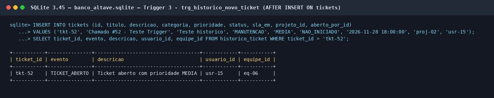
```text
+-----------+---------------+------------------------------------+------------+-----------+
| ticket_id | evento        | descricao                          | usuario_id | equipe_id |
+-----------+---------------+------------------------------------+------------+-----------+
| tkt-52    | TICKET_ABERTO | Ticket aberto com prioridade MEDIA | usr-15     | eq-06     |
+-----------+---------------+------------------------------------+------------+-----------+
```

#### Trigger 4: `trg_historico_mudanca_status`
- **Problema:** Sempre que o `status` de um ticket for atualizado, gravar automaticamente no histórico qual era o status anterior e qual é o novo status.
- **Código SQL:**
```sql
CREATE TRIGGER trg_historico_mudanca_status
AFTER UPDATE OF status ON tickets
FOR EACH ROW
WHEN OLD.status != NEW.status
BEGIN
    INSERT INTO historico_ticket (id, evento, descricao, criado_em, ticket_id, usuario_id, equipe_id, inicio_equipe_id)
    VALUES (
        'hist-' || lower(hex(randomblob(4))),
        'MUDANCA_STATUS',
        'Status alterado de ' || OLD.status || ' para ' || NEW.status,
        CURRENT_TIMESTAMP,
        NEW.id,
        NEW.responsavel_id,
        (SELECT equipe_id FROM usuarios WHERE id = NEW.responsavel_id),
        NULL
    );
END;
```
- **Retorno obtido:**
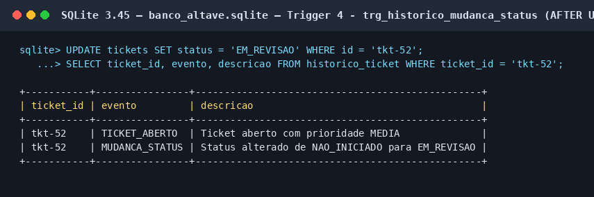
```text
+-----------+----------------+-------------------------------------------------+
| ticket_id | evento         | descricao                                       |
+-----------+----------------+-------------------------------------------------+
| tkt-52    | TICKET_ABERTO  | Ticket aberto com prioridade MEDIA              |
| tkt-52    | MUDANCA_STATUS | Status alterado de NAO_INICIADO para EM_REVISAO |
+-----------+----------------+-------------------------------------------------+
```

#### Trigger 5: `trg_historico_novo_relatorio`
- **Problema:** Quando um técnico enviar um relatório na tabela `relatorios`, registrar o evento no histórico do ticket e mudar o status do ticket de `'NAO_INICIADO'` para `'EM_ANDAMENTO'`.
- **Código SQL:**
```sql
CREATE TRIGGER trg_historico_novo_relatorio
AFTER INSERT ON relatorios
FOR EACH ROW
BEGIN
    INSERT INTO historico_ticket (id, evento, descricao, criado_em, ticket_id, usuario_id, equipe_id, inicio_equipe_id)
    VALUES (
        'hist-' || lower(hex(randomblob(4))),
        'RELATORIO_ADICIONADO',
        'Relatório registrado pelo técnico ' || NEW.autor_id,
        CURRENT_TIMESTAMP,
        NEW.ticket_id,
        NEW.autor_id,
        (SELECT equipe_id FROM usuarios WHERE id = NEW.autor_id),
        NULL
    );

    UPDATE tickets
    SET status = 'EM_ANDAMENTO',
        atualizado_em = CURRENT_TIMESTAMP
    WHERE id = NEW.ticket_id
      AND status = 'NAO_INICIADO';
END;
```
- **Retorno obtido:**
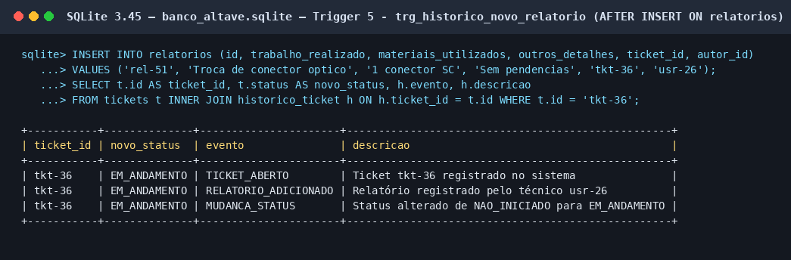
```text
+-----------+--------------+----------------------+---------------------------------------------------+
| ticket_id | novo_status  | evento               | descricao                                         |
+-----------+--------------+----------------------+---------------------------------------------------+
| tkt-36    | EM_ANDAMENTO | TICKET_ABERTO        | Ticket tkt-36 registrado no sistema               |
| tkt-36    | EM_ANDAMENTO | RELATORIO_ADICIONADO | Relatório registrado pelo técnico usr-26          |
| tkt-36    | EM_ANDAMENTO | MUDANCA_STATUS       | Status alterado de NAO_INICIADO para EM_ANDAMENTO |
+-----------+--------------+----------------------+---------------------------------------------------+
```

#### Trigger 6: `trg_bloquear_encerramento_sem_relatorio`
- **Problema:** Impedir que um ticket seja alterado para `'ENCERRADO'` caso não exista nenhum relatório técnico vinculado a ele na tabela `relatorios`.
- **Código SQL:**
```sql
CREATE TRIGGER trg_bloquear_encerramento_sem_relatorio
BEFORE UPDATE OF status ON tickets
FOR EACH ROW
WHEN NEW.status = 'ENCERRADO'
 AND OLD.status != 'ENCERRADO'
 AND (SELECT COUNT(*) FROM relatorios WHERE ticket_id = NEW.id) = 0
BEGIN
    SELECT RAISE(ABORT, 'Erro: Nao e permitido encerrar um ticket sem relatorio tecnico cadastrado.');
END;
```
- **Retorno obtido:**
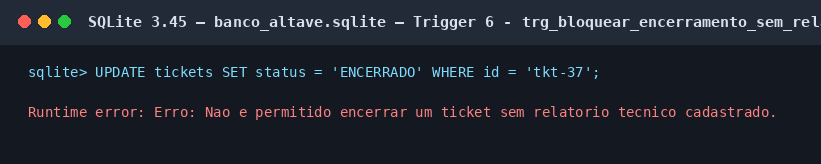
```text
Runtime error: Erro: Nao e permitido encerrar um ticket sem relatorio tecnico cadastrado.
```

---

## Parte 4 – Documentação do Banco de Dados (Dicionário de Dados)

O dicionário de dados completo com a descrição de todas as 9 tabelas, tipos de dados do SQLite (`TEXT`, `INTEGER`, `DATETIME`), chaves primárias (`PK`), chaves estrangeiras (`FK`) e restrições está no arquivo separado:

- **[`04_dicionario_de_dados.md`](./04_dicionario_de_dados.md)**

---

## Parte 5 – Conexão do Projeto API ao Banco de Dados

### Funcionalidade Escolhida
Abertura de um novo Ticket pela API ([`05_integracao_api/integracao_sqlite.py`](./05_integracao_api/integracao_sqlite.py)) conectada ao arquivo SQLite [`banco_altave.sqlite`](./banco_altave.sqlite), utilizando:
- **1 Stored Procedure:** `sp_abrir_ticket` (insere o chamado e vincula a equipe responsável em `ticket_equipes`).
- **1 Function:** `fn_total_tickets_projeto` (retorna o total atualizado de tickets do projeto).

### Código da Integração com o SQLite (`05_integracao_api/integracao_sqlite.py`)
```python
import sqlite3
import json

DB_PATH = "banco_altave.sqlite"

def fn_total_tickets_projeto(projeto_id):
    conn = sqlite3.connect(DB_PATH)
    total = conn.execute("SELECT COUNT(*) FROM tickets WHERE projeto_id = ?", (projeto_id,)).fetchone()[0]
    conn.close()
    return total

def sp_abrir_ticket(conn, ticket_id, titulo, descricao, categoria, prioridade, sla_em, projeto_id, aberto_por_id, equipe_id):
    cur = conn.cursor()
    cur.execute('''
        INSERT INTO tickets (id, titulo, descricao, categoria, prioridade, status, sla_em, projeto_id, aberto_por_id)
        VALUES (?, ?, ?, ?, ?, 'NAO_INICIADO', ?, ?, ?)
    ''', (ticket_id, titulo, descricao, categoria, prioridade, sla_em, projeto_id, aberto_por_id))

    cur.execute("INSERT INTO ticket_equipes (id, ticket_id, equipe_id) VALUES (?, ?, ?)",
                ("te-" + ticket_id, ticket_id, equipe_id))
    conn.commit()
    return cur.execute(
        "SELECT ticket_id, titulo, categoria, prioridade, status, projeto, cliente FROM vw_resumo_tickets WHERE ticket_id = ?",
        (ticket_id,)
    ).fetchone()
```

### Evidência da Execução:

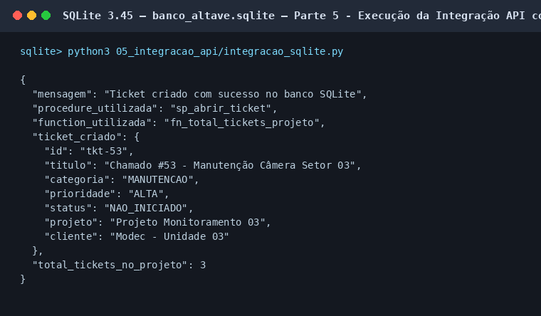

```json
{
  "mensagem": "Ticket criado com sucesso no banco SQLite",
  "procedure_utilizada": "sp_abrir_ticket",
  "function_utilizada": "fn_total_tickets_projeto",
  "ticket_criado": {
    "id": "tkt-53",
    "titulo": "Chamado #53 - Manutenção Câmera Setor 03",
    "categoria": "MANUTENCAO",
    "prioridade": "ALTA",
    "status": "NAO_INICIADO",
    "projeto": "Projeto Monitoramento 03",
    "cliente": "Modec - Unidade 03"
  },
  "total_tickets_no_projeto": 3
}
```
