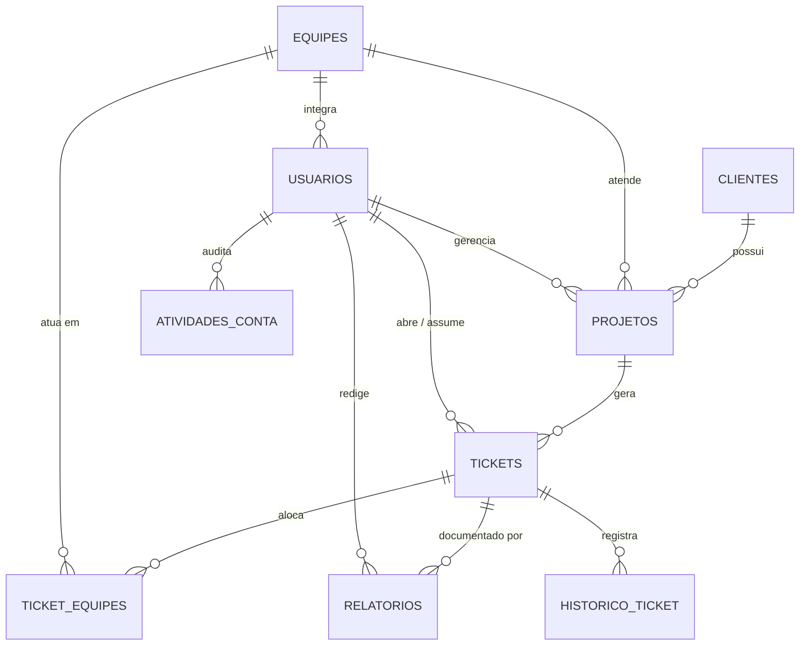

# 🗄️ Arquitetura do Banco de Dados e Regras de Negócio

Este documento apresenta de forma clara como o negócio do sistema funciona e como o banco de dados (**MySQL** gerenciado via **Prisma ORM**) foi estruturado para garantir desempenho, segurança e rastreabilidade em toda a operação.

---

## 🎯 1. Visão Geral do Negócio

O projeto consiste em uma **Plataforma Unificada de Ordens de Serviço (Tickets)** desenvolvida para a **Altave**, empresa especializada em monitoramento inteligente com visão computacional e Inteligência Artificial aplicada a ambientes críticos (como plataformas petrolíferas offshore e embarcações marítimas).

### O Problema que o Sistema Resolve
Antes da plataforma, o fluxo operacional era fragmentado: cada equipe utilizava ferramentas isoladas para controlar suas tarefas. Isso gerava ruídos de comunicação, dificuldade para acompanhar prazos (**SLA**) e perda de histórico sobre o que foi feito em cada equipamento ou cliente.

### Como a Operação Funciona na Plataforma
1. **Fechamento e Abertura de Projeto (`Comercial`)**: Quando um novo contrato é firmado com um **Cliente** (ex.: instalação de câmeras ATEX ou visão computacional em um navio), o projeto é cadastrado já vinculado a um **Gestor** e a uma **Equipe** principal, gerando automaticamente o primeiro ticket de instalação.
2. **Abertura e Triagem de Chamados (`Suporte`)**: Sempre que surge uma demanda de **Instalação** ou **Manutenção**, um **Ticket** é aberto com prioridade definida (`BAIXA`, `MEDIA`, `ALTA` ou `CRITICA`) e um prazo limite de atendimento (**SLA**).
3. **Alocação e Colaboração entre Times (`Gestor` e `Técnico`)**: Um ticket pode exigir mais de uma especialidade (por exemplo, a equipe de *Instalação Offshore* trabalhando em conjunto com a equipe de *Visão Computacional & IA*). O sistema permite alocar múltiplas equipes ao mesmo chamado e notifica os responsáveis.
4. **Execução e Relatório Técnico (`Técnico`)**: Durante o atendimento, os técnicos registram **Relatórios** detalhando o trabalho realizado, os materiais utilizados e observações adicionais, além de alimentar a linha do tempo do chamado.
5. **Revisão e Encerramento**: Ao concluir o serviço, o técnico solicita o encerramento, que passa por validação antes de o chamado ser oficialmente finalizado.

---

## 🧱 2. Estrutura das Tabelas

O banco de dados é composto por **8 tabelas principais** e **4 enumeradores (`Enums`)** que padronizam os estados do sistema:

| Tabela | Papel no Negócio |
| :--- | :--- |
| **`clientes`** | Empresas contratantes dos serviços e projetos de monitoramento. |
| **`equipes`** | Times operacionais divididos por especialidade técnica. |
| **`usuarios`** | Colaboradores da plataforma, organizados por cargo (`TECNICO`, `GESTOR`, `SUPORTE`, `SUPORTE_INTERNO`, `COMERCIAL`). |
| **`projetos`** | Contratos ativos dos clientes, contendo o local de instalação, a equipe responsável e o gestor do projeto. |
| **`tickets`** | As ordens de serviço em si, contendo categoria, prioridade, status atual, prazos de SLA e responsáveis. |
| **`ticket_equipes`** | Tabela associativa (N:N) que permite alocar uma ou várias equipes em um mesmo ticket. |
| **`relatorios`** | Registros técnicos de campo preenchidos pelos técnicos (reparo feito, materiais gastos e observações). |
| **`historico_ticket`** | Linha do tempo completa (logs) com cada ação ou mudança de status ocorrida no chamado. |
| **`atividades_conta`** | Histórico administrativo de criação, edição e ativação/inativação de contas de usuários. |

### Diagrama de Relacionamentos (MER)

---

## ⭐ 3. Diferenciais e Pontos Fortes do Banco de Dados

A modelagem do banco não foi feita apenas para "guardar dados", mas sim desenhada para resolver problemas reais de concorrência, auditoria e velocidade de leitura:

### 🛡️ 1. Proteção Contra Perda de Dados (Soft Delete + Integridade Rígida)
* **Exclusão Lógica (`ativo = true/false`)**: Tabelas estruturais como `usuarios`, `equipes`, `clientes` e `projetos` nunca precisam ter seus registros deletados fisicamente quando deixam de operar. Basta inativá-los, preservando 100% do histórico de tickets antigos.
* **Travas de Segurança (`onDelete: Restrict`)**: O banco impede no nível relacional que um projeto, cliente ou ticket com histórico seja apagado por engano. Já dados transitórios, como o vínculo em `ticket_equipes`, utilizam `Cascade` ou `SetNull` onde apropriado.

### ⚡ 2. Índices Compostos Pensados para a Operação
Em vez de depender apenas de buscas simples, o banco conta com índices desenhados exatamente para as telas mais acessadas do sistema:
* **Fila Inteligente (`ix_tickets_fila`)**: Índice composto por `(projeto_id, status, prioridade, criado_em)`. Ele permite que a listagem principal filtre e ordene os chamados mais urgentes no topo da fila instantaneamente, mesmo com milhares de tickets cadastrados.
* **Monitoramento de SLA (`ix_tickets_sla`)**: Índice composto por `(status, sla_em)`, ideal para identificar rapidamente chamados em aberto cujo prazo de atendimento está prestes a vencer.
* **Unicidade Contextual (`uq_projetos_cliente_nome`)**: Garante que um mesmo cliente não tenha dois projetos com nomes idênticos cadastrados por engano, mantendo a base limpa.

### 🔍 3. Auditoria Fiel no Tempo (Imune a Mudanças de Equipe)
Um problema comum em sistemas de chamados acontece quando um técnico muda de equipe e os relatórios antigos passam a exibir a equipe nova.
* No nosso banco, a tabela **`historico_ticket`** grava não só o `usuario_id`, mas também uma fotografia do `equipe_id` daquele usuário no exato momento do evento. Se o técnico trocar de setor no futuro, o histórico do ticket continua mostrando fielmente por qual equipe ele atuava na época.
* Além disso, a tabela **`usuarios`** possui auto-relacionamento (`criado_por_id`) e a tabela **`atividades_conta`**, permitindo rastrear quem criou, editou ou desativou qualquer perfil na plataforma.

### 🔒 4. Controle de Concorrência Direto no Banco
Na tabela `historico_ticket`, existe a coluna `inicio_equipe_id` combinada com o índice único `uq_historico_inicio_equipe (ticket_id, inicio_equipe_id)`.
* **Por que isso é excelente?** Se dois técnicos da mesma equipe clicarem em "Iniciar Atividade" exatamente no mesmo milissegundo, o próprio MySQL bloqueia a duplicidade do evento de início, enquanto continua permitindo múltiplos outros logs normais (onde `inicio_equipe_id` é `NULL`).

### 🔑 5. Padronização, Segurança e Precisão
* **Identificadores em UUID (`CHAR(36)`)**: Todas as chaves primárias utilizam UUID v4 em vez de números sequenciais (`1, 2, 3...`), evitando que alguém descubra o volume de dados ou tente adivinhar URLs de outros projetos e tickets.
* **Tipagem Forte com `Enums`**: Status, prioridades, categorias e cargos são validados diretamente pelo banco de dados, impedindo a inserção de valores fora do padrão.
* **Precisão de Milissegundos (`DateTime(3)`)**: Todos os registros de data e hora possuem precisão de milissegundos, garantindo a ordem cronológica exata dos eventos no histórico do chamado.

